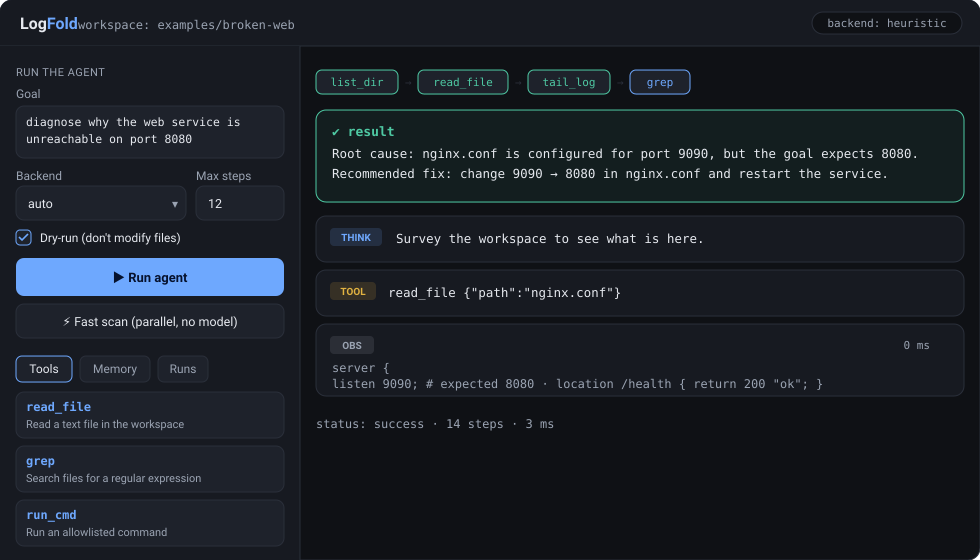
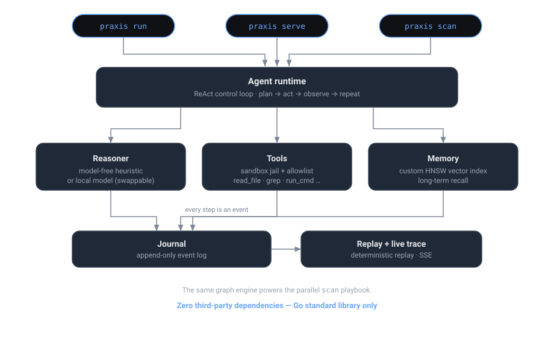

<h1 align="center">Praxis</h1>

<p align="center">
  <b>An AI-agent runtime and DevOps automation platform — built entirely from scratch in Go, with zero third-party dependencies.</b>
</p>

<p align="center">
  <a href="https://github.com/Atishay8192261/praxis/actions/workflows/ci.yml"></a>
  
  
  
</p>

<p align="center">
  
</p>

Praxis is an autonomous agent that **diagnoses and fixes broken software services**. You give it a goal in plain English — *"diagnose why the web service is unreachable on port 8080"* — and it plans, inspects your files, configs, logs, and ports with sandboxed tools, and either explains the root cause or applies the fix. A live web workbench streams every reasoning step as it happens.

What makes it unusual: the entire agent runtime underneath — the planning loop, the tool protocol, the vector memory, the workflow engine, the web server — is **hand-built on the Go standard library**. No LangChain, no vector database, no web framework, no SDKs. It's the infrastructure those tools provide, implemented from first principles.

---

## Highlights

- 🧠 **A complete agent runtime, from scratch** — ReAct planning loop, a typed function-calling tool protocol, and a graph workflow engine with parallel execution. No agent framework used.
- 🔒 **Sandboxed and safe** — every file and command goes through an escape-proof workspace jail (symlink-aware) with a command allowlist, timeouts, and a dry-run mode.
- 🗂️ **Custom vector memory** — a hand-written **HNSW** approximate-nearest-neighbor index gives the agent long-term recall across runs. *recall@10 = 1.0, ~2,800 queries/sec.*
- ⏪ **Deterministic replay** — every run is an append-only event log, so any run can be replayed exactly for debugging.
- 🔌 **Bring your own model — or none** — talks to any OpenAI-compatible local model (Ollama, llama.cpp, …), and ships a model-free heuristic backend so it works out of the box.
- 🧪 **Production hygiene** — 48 tests (passing under the race detector), an adversarial code-review pass, GitHub Actions CI, and a distroless Docker image.
- 📦 **Zero third-party dependencies** — `go.mod` has no `require` block. Everything is the standard library.

## See it in action

```console
$ praxis run "diagnose why the web service is unreachable on port 8080"
▸ think  Survey the workspace to see what is here.
  → tool   list_dir {"path":"."}
  ← obs    file  README.md · file  app.log · file  nginx.conf   (0ms)
▸ think  Inspect the configuration file "nginx.conf".
  → tool   read_file {"path":"nginx.conf"}
  ← obs    server { listen 9090; ... location /health { return 200 "ok"; } }   (0ms)
▸ think  Check "app.log" for recent errors.
  → tool   tail_log {"path":"app.log","lines":40}
  ← obs    ... ERROR connection refused on 127.0.0.1:8080 ...   (0ms)

✔ result
Root cause: nginx.conf is configured for port 9090, but the goal expects port 8080.
Recommended fix: update nginx.conf to listen on 8080 (change 9090 -> 8080) and restart.

status: success   steps: 14   elapsed: 3ms
```

Ask it to **fix** instead of diagnose and it rewrites the config itself, then tells you to restart and verify.

## Quickstart

```sh
git clone https://github.com/Atishay8192261/praxis && cd praxis
go build -o praxis ./cmd/praxis        # no dependencies to download

# Diagnose a deliberately-broken demo service (no AI model required):
./praxis run  -C examples/broken-web "diagnose why the web service is unreachable on port 8080"

# Let the agent fix it:
./praxis run  -C examples/broken-web "fix the config so the gateway listens on port 8080"

# A fast, parallel, model-free triage of any workspace:
./praxis scan -C examples/broken-web

# Launch the web workbench, then open http://localhost:7777
./praxis serve -C examples/broken-web
```

**Use a real model** (optional). Praxis speaks the OpenAI chat API, so any local server works:

```sh
export PRAXIS_MODEL_URL=http://127.0.0.1:11434/v1   # e.g. Ollama
export PRAXIS_MODEL_NAME=llama3.1
./praxis run -backend model "the health endpoint is failing — investigate and fix it"
```

## How it's built

<p align="center">
  
</p>

An agent run is nothing but an ordered list of events. The live view and any later replay are both a pure fold over that log — which is what makes runs reproducible. Each of these pieces is implemented directly on the standard library:

| Component | What it does |
|---|---|
| **Event journal + replay** | Append-only log; every run replays deterministically, even after a crash |
| **Tool protocol** | JSON-schema params, validation, dispatch with retry — hand-built "function calling" |
| **Sandbox** | Symlink-aware path jail + command allowlist + timeouts + dry-run |
| **Reasoner** | Swappable brain: a model-free heuristic backend, or an OpenAI-compatible model client with its own JSON action protocol |
| **ReAct agent loop** | plan → act → observe, with a step budget, loop guard, and self-correction |
| **HNSW vector memory** | From-scratch ANN graph index + text vectorizer for long-term recall |
| **Graph engine** | Typed workflow engine: conditional branches, parallel fan-out/fan-in, bounded loops |
| **HTTP server + SSE** | Standard-library REST API + live event streaming, serving an embedded single-page UI |

## Benchmarks

Single-threaded, `go test -bench` (see `internal/memory/bench_test.go`):

| Benchmark | Result |
|---|---|
| HNSW search — 10k × 128-dim vectors | **~2,800 queries/sec** (357 µs) |
| HNSW recall@10 vs. brute force | **1.00** |
| Text embedding | **~354,000 embeds/sec** (2.8 µs) |
| End-to-end diagnosis (heuristic backend) | **~3 ms** per run |

## Development

```sh
make build      # build ./praxis
make test       # go test ./...
make race       # go test -race ./...
make bench      # benchmarks
make serve      # build + serve the demo workspace
```

Verify the zero-dependency claim: `cat go.mod` shows no `require` block, and `go list -m all` lists only this module.

## Roadmap

- [x] Event-sourced runtime with deterministic replay
- [x] Sandboxed DevOps agent that diagnoses **and** fixes
- [x] Custom HNSW vector memory + parallel graph engine
- [x] Web workbench with live streaming
- [x] Benchmarks, CI, Docker, security-hardening pass
- [ ] Multi-agent coordination over a shared blackboard
- [ ] Streaming token output from the model backend

## License

MIT © Atishay Jain
